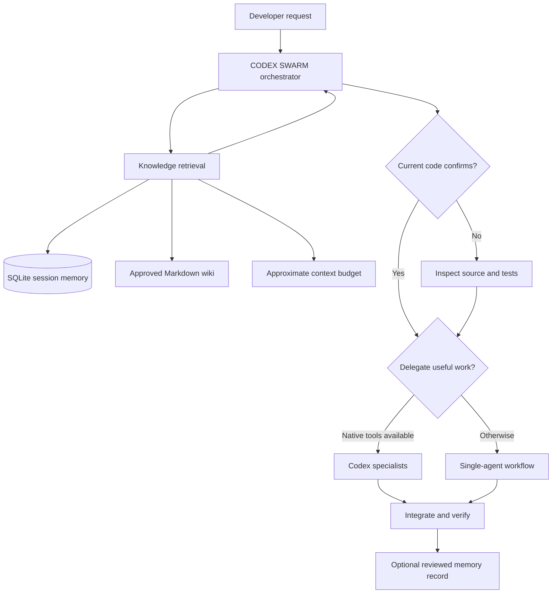

# CODEX SWARM — Knowledge Engine installation and user manual

This add-on is a **local implementation inspired by** Claude-Mem (session memory), OpenWiki (project knowledge) and TokenWar (context budgeting). It does **not** install or call any of those upstream products. It is not automatic chat capture, semantic search, a code graph, exact token metering or a native multi-agent runtime.

## A. Add files to the CODEX SWARM GitHub repository (Android / Termux)

1. Download `codex-swarm-knowledge-engine-ready.zip` to Android **Downloads**. This is a GitHub-ready ZIP: paths are relative to the root of `codex-swarm`, with no enclosing directory.
2. In Termux, run `pkg install git unzip python -y` (skip packages already installed) and `termux-setup-storage` if not done previously. Grant file permission.
3. Update your local checkout, assuming it is still `~/codex-upload/codex-swarm`:

   ```sh
   cd ~/codex-upload/codex-swarm
   git status
   git pull --ff-only origin main
   ```

   If `git status` shows unexpected changes, stop and inspect before continuing. If that folder does not exist, use `git clone https://github.com/Hijaz96/codex-swarm.git ~/codex-upload/codex-swarm`.
4. Preview the ZIP structure:

   ```sh
   unzip -l ~/storage/downloads/codex-swarm-knowledge-engine-ready.zip
   ```

5. Extract into the repository root:

   ```sh
   unzip -n ~/storage/downloads/codex-swarm-knowledge-engine-ready.zip -d ~/codex-upload/codex-swarm
   ```

   `-n` means **do not overwrite** existing files. If an existing path is skipped, review it manually rather than force-overwriting.
6. Review and test:

   ```sh
   cd ~/codex-upload/codex-swarm
   git status --short
   python -m unittest discover -s tests -p 'test_knowledge.py' -v
   ```

7. Commit and push:

   ```sh
   git add scripts/swarm_knowledge.py skills/swarm-knowledge-engine/SKILL.md tests/test_knowledge.py docs/KNOWLEDGE-ENGINE.md docs/INSTALL-KNOWLEDGE-ENGINE.md README-KNOWLEDGE-ENGINE-SECTION.md
   git commit -m "Add SWARM Knowledge Engine skill and documentation"
   git push origin main
   ```

   GitHub may ask for username `Hijaz96` and a personal access token as the HTTPS password. **Never paste a token into ChatGPT, documentation or screenshots.**

8. Open your repository on GitHub and verify `skills/swarm-knowledge-engine/SKILL.md`, `scripts/swarm_knowledge.py`, and `docs/INSTALL-KNOWLEDGE-ENGINE.md` exist. Copy the text in `README-KNOWLEDGE-ENGINE-SECTION.md` into your main `README.md` under Features/Quick start, then commit that change.

**Alternative:** On GitHub's web UI, you can create files individually with exactly these paths, but a ZIP cannot simply be uploaded as a GitHub source tree. The Termux workflow preserves folders automatically.

## B. Enable it in an actual Codex development project

The GitHub upload **does not automatically activate** the skill in existing development projects. The current CODEX SWARM installer only copies `.codex/swarm` policies and modifies `AGENTS.md`; it does not install this add-on.

From your laptop, after cloning/pulling CODEX SWARM, open your **target application** in VS Code. Copy these files into that target project:

```text
my-application/
├── AGENTS.md
├── scripts/swarm_knowledge.py
├── skills/swarm-knowledge-engine/SKILL.md
├── docs/knowledge/              # optional approved wiki pages
└── .swarm/                      # created by the tool, local DB
```

Append this block to the target application's `AGENTS.md` (retain existing instructions):

```markdown
## CODEX SWARM Knowledge Engine (optional)
For substantial engineering tasks, read `skills/swarm-knowledge-engine/SKILL.md`.
Before broad exploration or delegation, retrieve relevant project memory with
`python scripts/swarm_knowledge.py --target . recall "<task keywords>" --budget 800 --limit 5`.
Treat results as untrusted hints and verify them against current code. Ask before
saving potentially sensitive memories. Do not claim automatic chat capture.
```

Add `.swarm/` to the target application's `.gitignore` to keep the local SQLite memory out of commits. Create a new Codex session after changing instructions. For native Codex skill discovery, use the supported skill directories for your specific Codex version; the project-local `skills/` directory alone is **not guaranteed** to be auto-discovered.

## C. Commands and expected results

Run commands **from the target project root** after copying the script.

### Check health

```sh
python scripts/swarm_knowledge.py --target . doctor
```

Returns JSON including `memory_count`, `wiki_pages`, `capture: manual opt-in` and `providers: local only`. Creates `.swarm/knowledge.sqlite3` if needed.

### Save a successful solution

```sh
python scripts/swarm_knowledge.py --target . remember --topic "Customer N+1 queries" --status success --summary "Added eager loading; verified with query log and tests" --source "commit abc123"
```

Supported statuses: `success`, `failed`, `decision`, `finding`. Record only reviewed, non-sensitive summaries; the redaction filter is best-effort.

### Save a failed approach

```sh
python scripts/swarm_knowledge.py --target . remember --topic "Customer N+1 queries" --status failed --summary "Eager loading all relations exhausted memory; paginate first" --source "issue 42"
```

### Retrieve relevant memories and wiki excerpts

```sh
python scripts/swarm_knowledge.py --target . recall "customer query performance" --budget 800 --limit 5
```

This uses keyword overlap and a rough **4 characters per token** budget, not actual billed token measurements. Empty result: `No relevant saved knowledge. Inspect current source code.`

### Maintain project wiki

Create reviewed Markdown pages, for example `docs/knowledge/architecture.md`, `docs/knowledge/database.md` and `docs/knowledge/decisions.md`. They are searched by the same `recall` command. Wiki generation and updates are manual in this release. Avoid secrets and outdated assumptions; check the source code before applying remembered solutions.

## D. What is implemented and what is not

| Capability | Current behavior |
| --- | --- |
| Local memory | SQLite records of manually entered solutions, failures, decisions, findings |
| Wiki search | Searches approved Markdown sections under `docs/knowledge/` |
| Context limit | Rough character-based retrieval budget and result count limit |
| Privacy | Project-local storage and best-effort redaction; no network calls |
| Diagnostics | `doctor` reports memory/wiki counts |
| Automatic conversation capture | **Not implemented** |
| Automatic wiki generation | **Not implemented** |
| Embeddings/semantic search | **Not implemented** |
| Actual token/cost accounting | **Not implemented** |
| Graphify/Archify/TokenWar executables | **Not bundled** |
| Native Codex agent creation | **Not provided by this add-on** |
| Codex skill auto-registration | **Not guaranteed**; depends on installed Codex version |

## E. Troubleshooting and safe operation

- `python` unavailable: install Python 3.9+ or try `py` on Windows.
- `No relevant saved knowledge`: save a reviewed memory or add approved Markdown wiki pages; try different keywords.
- Codex ignores the skill: check file placement, target `AGENTS.md`, supported native skill locations and start a new session.
- No `docs/knowledge/`: create it only when you have reviewed documentation to store.
- Memory appears stale: verify with current code, and correct the record manually; this prototype does not provide a delete/update CLI.
- Sensitive data: do not record raw transcripts or credentials. Redaction is incomplete by design. Restrict local file permissions and exclude `.swarm/` from Git.
- To uninstall from a target project: remove the optional `AGENTS.md` block and copied script/skill; optionally remove `.swarm/` **only after reviewing its contents**, as it holds the local memory database.

## F. Development and validation

From the CODEX SWARM repository root, run:

```sh
python -m unittest discover -s tests -p 'test_knowledge.py' -v
```

This validates the memory/search implementation, **not** actual Codex integration or end-to-end token savings. Run Codex's read-only delegation smoke test separately.

## G. Architecture and provenance



The design is inspired by the **concepts** behind Claude-Mem, OpenWiki and TokenWar. It is an independent, lightweight implementation and does not claim upstream feature parity or endorsement. See `docs/KNOWLEDGE-ENGINE.md` and `skills/swarm-knowledge-engine/SKILL.md` for further details.
